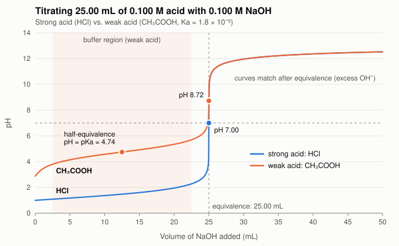
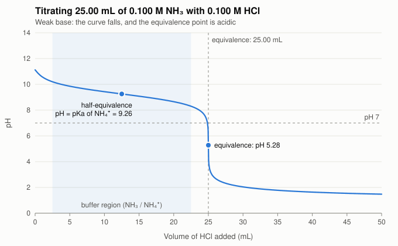
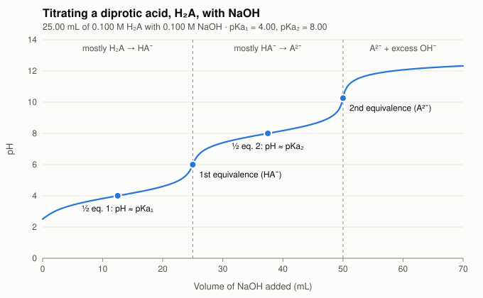

# 4. Titrations

AP topic **8.5 Acid–Base Titrations**

> **Goal:** Read a titration curve to find the equivalence point, the half-equivalence point, Ka, and an unknown concentration. Calculate the pH at any point in a monoprotic titration.

The official course description notes that students often struggle with the topics below, so expect to see them on the exam:
- using a curve to find the **equivalence** and **half-equivalence** points
- calculating the concentration of an unknown, or the pH at a given point
- **justifying the choice of indicator**
- confusing **half-equivalence, equivalence, and endpoint**

## Vocabulary

| Term | Meaning |
|---|---|
| **analyte** | the solution of unknown concentration, in the flask |
| **titrant** | the solution of known concentration, in the buret |
| **equivalence point** | moles of titrant added = moles of analyte originally present (for monoprotic acids and bases) |
| **endpoint** | where the indicator changes color. A good indicator makes this match the equivalence point. |
| **half-equivalence point** | half the volume needed to reach equivalence. Half the analyte has reacted, so [HA] = [A⁻]. |

## The two key facts

**1. At equivalence, moles of acid = moles of base (monoprotic).**

```
M_acid × V_acid = M_base × V_base        → find an unknown concentration
```

**2. At half-equivalence, pH = pKa.**

At this point [HA] = [A⁻], so in pH = pKa + log([A⁻]/[HA]) the log term is log(1) = 0. **Read the pH at half the equivalence volume and you have pKa**, and from it Ka = 10^(−pKa).

## Strong acid vs. weak acid curves



| | Strong acid (HCl) | Weak acid (CH₃COOH) |
|---|---|---|
| Starting pH | low (1.00) | higher (2.87), since only partly ionized |
| Early region | gradual rise | quick rise, then a flat **buffer region** |
| pH at half-equivalence | (no special meaning) | **= pKa = 4.74** |
| Vertical jump (24 → 26 mL) | large, about pH 3 → 11 | smaller, about pH 6 → 11 |
| pH at equivalence | **7.00** (neutral salt) | **> 7** (8.72), because CH₃COO⁻ is a weak base |
| After equivalence | same curve for both: excess OH⁻ sets the pH | |
| Equivalence **volume** | 25.00 mL | **25.00 mL, the same** |

The equivalence volume depends only on **moles** of acid, not on acid strength. This is a favorite multiple-choice question.

## The four regions of a weak acid titration

Titrating 25.00 mL of 0.100 M CH₃COOH (Ka = 1.8 × 10⁻⁵) with 0.100 M NaOH. Each region uses a method from an earlier folder:

| Region | NaOH added | What's in the flask | Method | pH |
|---|---|---|---|---|
| 1. Start | 0 mL | weak acid only | ICE, [H₃O⁺] = √(Ka·C) (folder 2) | 2.87 |
| 2. Buffer region | 20.00 mL | CH₃COOH + CH₃COO⁻ | Henderson–Hasselbalch (folder 7) | 5.35 |
| ↳ half-equivalence | 12.50 mL | equal HA and A⁻ | pH = pKa | 4.74 |
| 3. Equivalence | 25.00 mL | CH₃COO⁻ only (0.0500 M) | Kb = Kw/Ka, then ICE (folder 3) | 8.72 |
| 4. Past equivalence | 30.00 mL | CH₃COO⁻ + excess OH⁻ | excess OH⁻ / total volume | 11.96 |

Calculations for each region:

```
Region 1:  [H₃O⁺] = √(1.8 × 10⁻⁵ × 0.100) = 1.34 × 10⁻³ M           pH = 2.87

Region 2:  2.00 mmol OH⁻ added to 2.50 mmol HA  →  0.50 mmol HA, 2.00 mmol A⁻
           pH = 4.74 + log(2.00 / 0.50) = 4.74 + 0.60 = 5.35

Region 3:  2.50 mmol A⁻ in 50.00 mL = 0.0500 M;  Kb = 5.6 × 10⁻¹⁰
           [OH⁻] = √(5.6 × 10⁻¹⁰ × 0.0500) = 5.3 × 10⁻⁶ M   pOH = 5.28   pH = 8.72

Region 4:  3.00 mmol OH⁻ − 2.50 mmol used = 0.50 mmol excess in 55.00 mL
           [OH⁻] = 9.1 × 10⁻³ M   pOH = 2.04   pH = 11.96
```

## Weak base titrated with strong acid



Everything flips:
- The curve starts high and **falls**.
- **At half-equivalence, pH = pKa of the conjugate acid** (NH₄⁺, 9.26). Equivalently, pOH = pKb.
- **At equivalence, pH < 7** (5.28), because NH₄⁺ is a weak acid.

## Polyprotic acids



A diprotic acid H₂A loses its protons **one at a time**:

```
H₂A + OH⁻ → HA⁻ + H₂O      (first)
HA⁻ + OH⁻ → A²⁻ + H₂O      (second)
```

- **Count the vertical jumps** to get the number of acidic protons. Two jumps means diprotic.
- The equivalence points are evenly spaced (25.00 mL and 50.00 mL here), because each proton takes the same number of moles of OH⁻.
- The pH at the first half-equivalence is about pKa₁, and at the second half-equivalence (halfway between the two equivalence points) it's about pKa₂.
- **Major species:** before the first equivalence, H₂A and HA⁻. At the first equivalence, mostly HA⁻. Between the two equivalence points, HA⁻ and A²⁻. After the second, A²⁻ (plus excess OH⁻).

**Not on the AP exam:** calculating the concentration of each species along a polyprotic curve. Identifying the major species (qualitative) and reading pKa values from the curve *is* tested.

## Lab: finding a concentration

**Example. 25.00 mL of an HCl solution is titrated with 0.1050 M NaOH, and the endpoint is reached at 18.62 mL. Find [HCl].**

```
mol NaOH = 0.01862 L × 0.1050 M = 1.955 × 10⁻³ mol = mol HCl
[HCl]    = 1.955 × 10⁻³ mol / 0.02500 L = 0.07820 M
```

## Lab error analysis

A common free-response format: *"How would this error affect the calculated concentration of the acid: too high, too low, or no effect? Justify."*

In these titrations, the calculated [acid] = (M_base × V_base) / V_acid. Ask what the error does to the **recorded V_base**.

| Error | Effect on recorded V_base | Calculated [acid] |
|---|---|---|
| Buret rinsed with water but not with NaOH, which dilutes the NaOH | more volume needed, so larger | **too high** |
| Endpoint overshot (indicator went too dark) | larger than true | **too high** |
| Air bubble in the buret tip that disappears during the titration | recorded volume larger than what was delivered | **too high** |
| Extra distilled water added to the flask with the acid | none, because moles of acid are unchanged | **no effect** |
| Some acid spilled before titrating | less base needed, so smaller | **too low** |
| Endpoint stopped too early | smaller | **too low** |

The "extra water in the flask" case appears every year. The **moles** of analyte set the equivalence point, and adding water doesn't change the moles.

## Common mistakes

- **Confusing equivalence with half-equivalence.** pH = pKa only at *half*.
- **Thinking a weak acid needs less base to reach equivalence.** It needs the same amount, because moles are what count.
- **Saying the pH at equivalence is always 7.** That's only true for strong/strong titrations.
- **Using the original volume after mixing.** At equivalence the volume is V_acid + V_base.
- **Treating endpoint and equivalence point as the same thing.** The endpoint is what you *observe*. The equivalence point is the stoichiometric point. A well-chosen indicator makes them nearly match (folder 6).

➡️ Next: [practice.md](practice.md)
